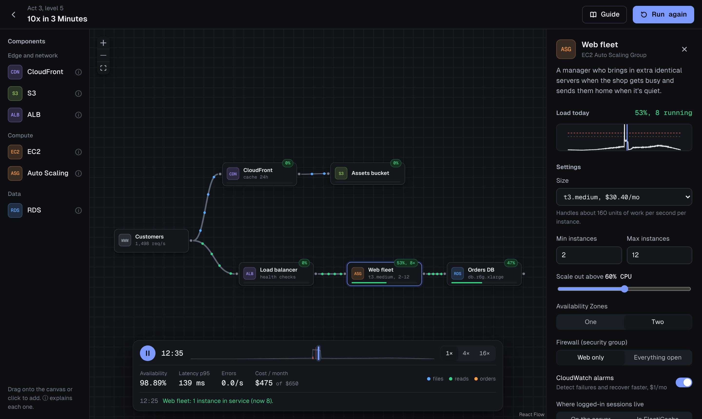
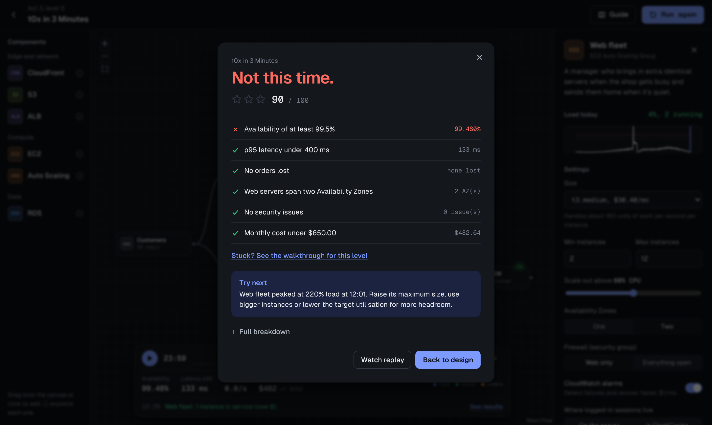
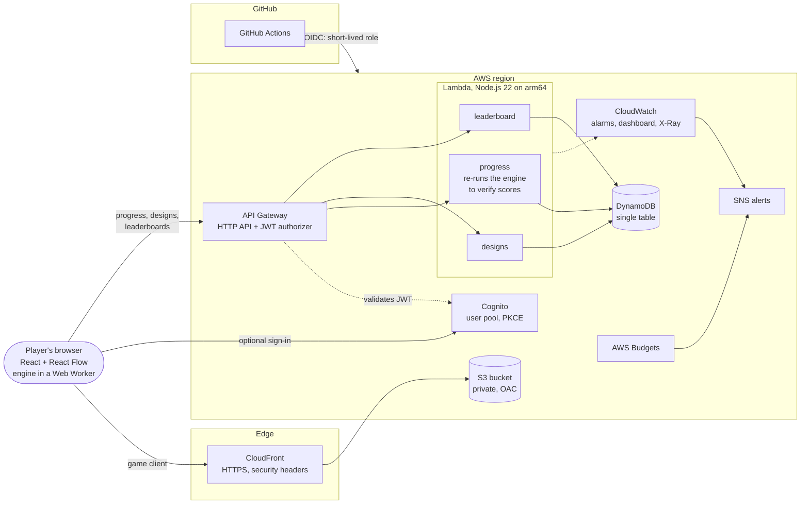
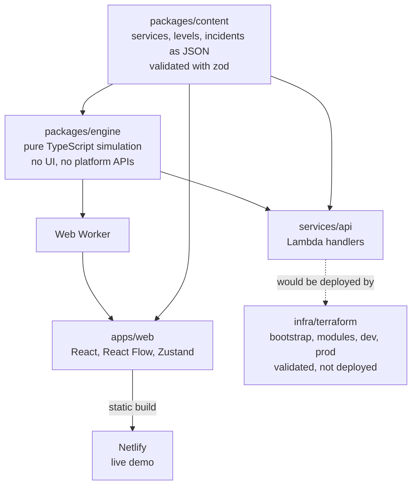

# Cloud Architect: Scale or Fail

**A browser puzzle game where you design, scale and rescue AWS architectures, from one server to a fleet that survives a 10x traffic spike.**

_"Factorio meets the AWS Well-Architected Framework."_

[](https://github.com/rasal-ss/cloud-architect-game/actions/workflows/ci.yml)


**▶ [Play the live demo](https://cloud-architect-game-web.netlify.app/)** (hosted on Netlify)



Every level is a real business problem with a budget, a traffic curve and failures that **will** happen. Drag
AWS services onto the canvas, connect them, configure them, then press Run. A simulated day plays out in 60
seconds: requests flow as coloured dots, components glow green, yellow or red with load, and chaos strikes at
dinner time. A report card scores you on the six pillars of the Well-Architected Framework.

## Why this project

This repository is a portfolio piece for DevOps, AWS Cloud and Tech Lead roles. It shows the same skills three
ways:

| Layer                         | What it demonstrates                                                                                                                                                                                                                                        |
| ----------------------------- | ----------------------------------------------------------------------------------------------------------------------------------------------------------------------------------------------------------------------------------------------------------- |
| **The game's content**        | System design knowledge: scaling, high availability, caching, replication, serverless, queues and events, disaster recovery, security and cost trade-offs                                                                                                   |
| **The game's code**           | A deterministic simulation engine with queueing, autoscaling and failure models; a graph editor; data-driven content validated by schemas; 181 automated tests                                                                                              |
| **The game's infrastructure** | Production-ready AWS infrastructure as code: serverless Terraform for dev and prod, GitHub Actions with OIDC (no long-lived keys), least-privilege IAM, alarms, dashboards and a budget alert. Validated in CI, not deployed: the live demo runs on Netlify |

## Play

The campaign has seven acts (35 levels) that follow NimbusCart from ten users to two million, plus a sandbox.

| Act                        | Story                                       | Levels                                                                                                                                               |
| -------------------------- | ------------------------------------------- | ---------------------------------------------------------------------------------------------------------------------------------------------------- |
| **1. Hello Cloud**         | The founder's weekend project, 10 users     | One EC2 server; Elastic IP and security groups; images in S3; CloudFront with a private bucket; **boss: launch day on $20**                          |
| **2. First Database**      | First paying customers, 1k users            | Database on the server; move to RDS before a crash; right-sizing; backups and private databases; **boss: don't lose a single order**                 |
| **3. Growing Pains**       | Featured on the app store, 50k users        | ALB and two servers; Auto Scaling on CPU; two Availability Zones; health checks and alarms; **boss: 10x in 3 minutes**                               |
| **4. Database Bottleneck** | Reads overwhelm the database, 200k users    | Read replicas; cache-aside with ElastiCache; TTL and stale data; replication lag; **boss: Black Friday with a cold cache**                           |
| **5. Always On**           | A 99.9% SLA, 500k users                     | Multi-AZ failover; stateless servers and sessions; backups vs Multi-AZ; surviving a lost zone; **boss: a zone goes dark at peak**                    |
| **6. Go Serverless**       | A mobile API, 1M users                      | API Gateway, Lambda and DynamoDB; Lambda memory and cold starts; partition keys; the RDS Proxy connection storm; **boss: the viral coupon**          |
| **7. Decouple Everything** | Order processing keeps timing out, 2M users | Queue the payments with SQS; fan-out with SNS; poison messages and dead-letter queues; EventBridge retries; **boss: the payment provider goes down** |

**17 services:** EC2, Auto Scaling, ALB, CloudFront, S3, RDS, read replicas, ElastiCache, API Gateway, Lambda,
DynamoDB, RDS Proxy, SQS, SNS, EventBridge, plus your customers and a third-party payment provider.

**9 kinds of chaos:** traffic spikes, instance crashes, Availability Zone outages, database failures, payment
provider outages, cache flushes, viral hot keys, a dropped table, and poison messages.

**No AWS experience needed.**

- **Service guide.** Searchable, available from every screen. Each service has an everyday analogy, a
  beginner overview, how it behaves in the game, when to use and avoid it, words to know, a worked NimbusCart
  example, common mistakes, what it pairs with, and its sizes and prices. 24 concept pages cover the ideas behind
  them, from latency and availability to RPO and RTO, hot partitions and idempotency.
- **Level intros.** The first time a level unlocks a service, a short card introduces it.
- **Walkthroughs.** Every level has a step-by-step answer and an explanation of why it works. After two failed
  runs the game offers it, and the answer can be loaded straight onto the canvas.



## Architecture

The simulation runs entirely in the player's browser, in a Web Worker, so the game needs nothing but static
hosting. **The live demo is a static site on Netlify**, and progress is saved in the browser.

The diagram below is the **target AWS architecture** for the cloud features (sign-in, cloud saves, shared designs
and leaderboards). It is fully defined in [infra/terraform](infra/terraform) and the API code is built and
tested, but it is **not deployed**: Terraform is checked with `fmt` and `validate` in CI. The design keeps the
bill near zero when nobody is playing, because the backend only stores progress, designs and leaderboards.



Inside the repository:



## Tech stack

| Area           | Choice                                                                                                                   |
| -------------- | ------------------------------------------------------------------------------------------------------------------------ |
| Monorepo       | pnpm workspaces, TypeScript (strict), ESLint, Prettier                                                                   |
| Frontend       | React 19, Vite 6, React Flow 12 for the canvas, Zustand for state                                                        |
| Simulation     | `packages/engine`: pure TypeScript, runs in a Web Worker, Node.js and Lambda                                             |
| Content        | JSON validated with zod schemas at load time; reference solutions per level                                              |
| Backend        | API Gateway HTTP API, Lambda (Node.js 22, arm64), DynamoDB single-table design                                           |
| Auth           | Cognito with PKCE (optional Google sign-in); the game is fully playable as a guest                                       |
| Hosting        | Netlify for the live demo (static build, configured in `netlify.toml`)                                                   |
| Infrastructure | Terraform 1.11 for AWS, reusable modules, dev and prod, S3 remote state with native lock files (validated, not deployed) |
| CI/CD          | GitHub Actions: lint, typecheck, tests, build, `terraform validate`; plan and apply via OIDC                             |
| Observability  | CloudWatch alarms and dashboard, X-Ray tracing, API access logs, AWS Budgets alert                                       |
| Testing        | Vitest across engine, content, API and web; level solvability tests run in CI                                            |

## How the simulation works

The engine is the heart of the game. It has to be **believable, explainable and deterministic**: the same design
always gives the same result.

1. **The design is a directed graph.** Each node is a service with a capacity, a latency and a price. Edges mean
   "sends requests to" and are checked against connection rules (Users → ALB is fine, Users → RDS is not).
2. **Traffic follows a daily curve.** Each tick is one simulated minute (1,440 per day). Requests are split into
   static files, reads and writes, with seeded random noise.
3. **Routing, in topological order.** Users and CloudFront pick the best-suited target per request type
   (CloudFront for images, the load balancer for pages). CloudFront answers cache hits at the edge, based on its
   TTL. The ALB splits by healthy capacity. Servers send reads to a cache, replicas or the primary, and writes to
   the primary. A server with no database keeps one on its own disk, which costs CPU, and is lost if it crashes.
   A request can make several calls in order: charge the card, save the order, publish an event.
4. **Capacity and queueing.** Every request costs a node some work units. Latency is nearly flat below 80% load,
   then rises sharply (an M/M/c-style knee); above 100%, the excess is dropped.
5. **Latency as distributions, not averages.** A backward pass combines each node's latency with its children's
   into small probability distributions, so a 90% cache hit rate really gives a fast p50 and a slower p95.
   Whole-day p50/p95/p99 come from a log-bucketed histogram.
6. **Autoscaling and failure.** Auto Scaling Groups track a target utilisation, with a 3-minute warm-up and a
   scale-in cooldown. Crashes pick a running instance with the seeded RNG. Health checks decide whether the ALB
   keeps routing to a dead target; alarms decide how fast a lone server recovers.
7. **Queues and events.** SQS, SNS and EventBridge end the customer's request as soon as a message is accepted.
   Queues keep a backlog that consumers drain at their own capacity, with retries, poison messages and
   dead-letter queues. SNS drops messages for a subscriber that can't keep up; EventBridge retries them.
8. **Serverless and data limits.** Lambda has a concurrency limit and cold starts, and every running execution
   opens a database connection. Relational databases refuse connections above their limit unless RDS Proxy pools
   them. DynamoDB throttles a partition key that gets too much traffic.
9. **Disasters.** Availability Zone outages, Multi-AZ failover, point-in-time restore after a dropped table, lost
   sessions on servers that disappear, and how stale cached and replicated data can get.
10. **Cost.** Hourly prices per component (per running instance for ASGs) plus per-request charges, projected to
    a monthly figure live during the run.
11. **Scoring.** Objectives (availability, p95, no data loss, budget, configuration checks) decide pass or fail.
    A 0-100 score weights the six Well-Architected pillars per level and turns into 1-3 stars. The report card adds
    bottlenecks, hints and a post-mortem timeline.

**Every level is proven solvable in CI.** The engine test suite runs each level's reference solution and requires
all objectives and 3 stars, across several random seeds. It also checks that each starting design fails, and that
key lessons hold: a bigger server instead of CloudFront blows the $20 budget in the Act 1 boss, Lambda without
RDS Proxy runs the database out of connections, and charging cards inside the customer's request fails during
the payment outage.

Game balance in numbers: in-game prices and capacities are tuned for gameplay and are approximate, not copied
from AWS pricing. The game never touches a real AWS account.

## Run locally

Requirements: Node.js 22 and pnpm 10.

```bash
pnpm install
```

```bash
pnpm dev
```

Open http://localhost:5173. Other useful commands:

```bash
pnpm test        # 181 tests: engine mechanics, level solvability, content, API, web
pnpm check       # lint + typecheck + test + build, exactly what CI runs
```

## Project structure

```
apps/web/              Game client: canvas, palette, inspector, playback, report card
packages/engine/       Simulation engine and scoring (UI-free, deterministic)
packages/content/      Service catalogue, campaign levels and reference solutions (JSON + zod)
services/api/          Lambda handlers: progress (server-verified), shared designs, leaderboards
infra/terraform/       AWS infrastructure as code: bootstrap, reusable modules, dev and prod (not deployed)
.github/workflows/     CI, plus an AWS Deploy workflow that stays inactive until AWS is configured
netlify.toml           Netlify build and headers for the live demo
docs/GAME_DESIGN.md    The full game design document
```

## Deployment

### Live demo: Netlify

The game is deployed to Netlify as a static site at **https://cloud-architect-game-web.netlify.app/**. Import the repository in Netlify and it picks up
[`netlify.toml`](netlify.toml): it builds `apps/web` with pnpm on Node.js 22 and publishes `apps/web/dist`.
Every push to `main` redeploys, and pull requests get preview links. Hashed assets are cached for a year and
`index.html` is always revalidated.

### AWS infrastructure (not deployed)

[`infra/terraform`](infra/terraform) defines the full AWS hosting for the cloud features: CloudFront and S3,
API Gateway and Lambda, DynamoDB, Cognito, CloudWatch alarms and a budget alert, for dev and prod. The
[Deploy workflow](.github/workflows/deploy.yml) would plan and apply it with short-lived GitHub OIDC credentials
(no stored AWS keys), with prod behind a manual approval. It stays inactive, and costs nothing, until the AWS
repository variables are set. CI still checks every Terraform module with `fmt` and `validate`. See
[infra/terraform/README.md](infra/terraform/README.md) for how it would be set up.

## Roadmap

| Phase | Name                     | Scope                                                                                                                                                                           | Status  |
| ----- | ------------------------ | ------------------------------------------------------------------------------------------------------------------------------------------------------------------------------- | ------- |
| 1     | **Prototype**            | Simulation engine, canvas, 8 services, traffic spike and instance crash, report card, Acts 1-3 (15 levels), sandbox                                                             | ✅ Done |
| 2     | **Core game**            | Acts 4-7: replicas and caching, Multi-AZ, serverless (Lambda, API Gateway, DynamoDB, RDS Proxy), SQS, SNS and EventBridge; 7 new incident types; service guide and walkthroughs | ✅ Done |
| 3     | **Data Architect mode**  | Second campaign: schema designer, Query Lab with execution plans, transactions, DynamoDB key design board, polyglot persistence                                                 | Next    |
| 4     | **Cloud backend launch** | Sign-in with Cognito, cloud saves, shared design links, server-verified leaderboards, daily challenges (API and Terraform built and tested, not deployed)                       | Built   |
| 5     | **Expansion**            | Acts 8-15 (security, analytics, CI/CD, multi-region, AI, the IPO), **Export to Terraform**, Incident Response and Cost Crusher modes                                            | Planned |

The full vision is in the [game design document](docs/GAME_DESIGN.md).

## License

[MIT](LICENSE)
